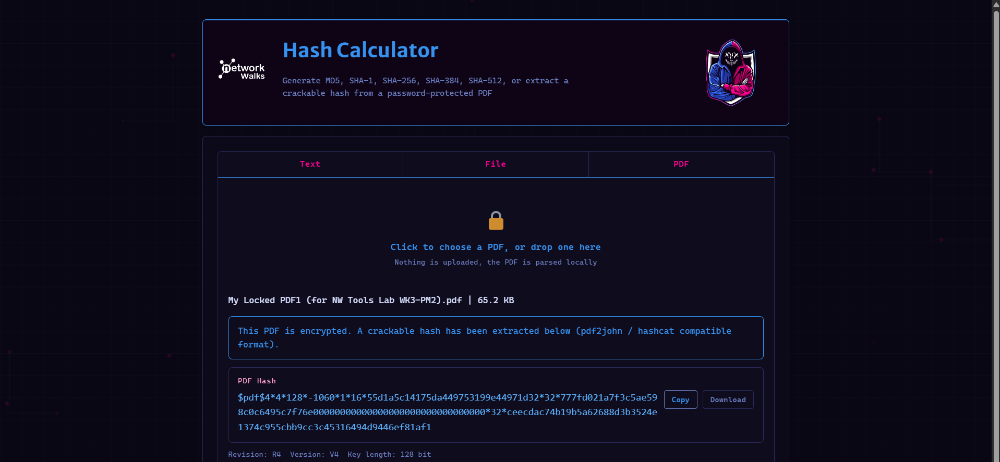
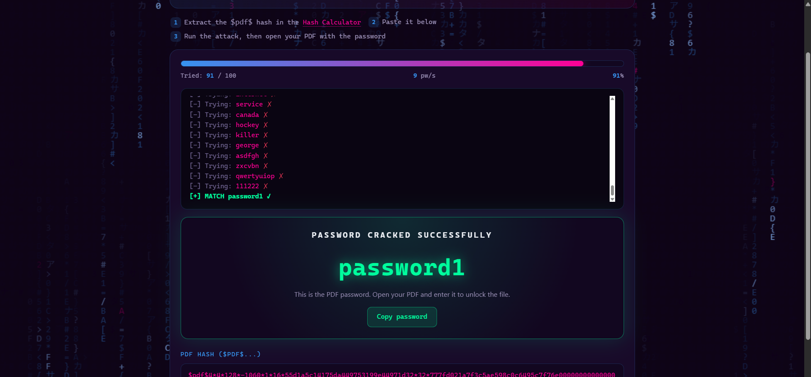
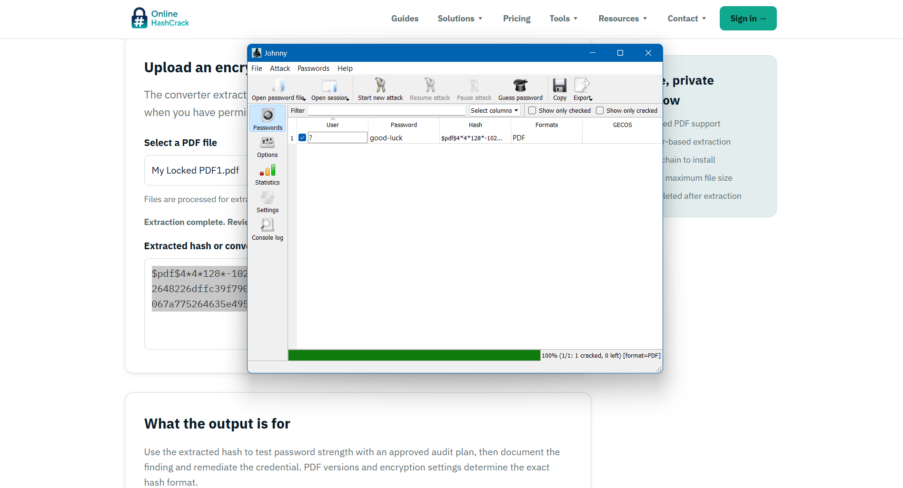
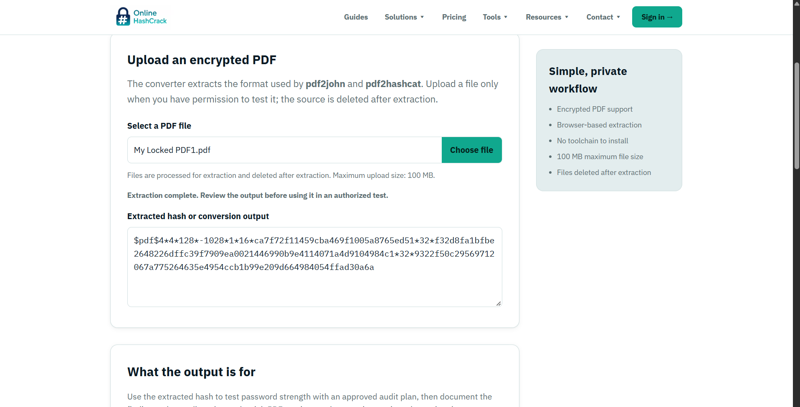

# Week 3 Cybersecurity Project: Password Auditing & Hash Analysis

A practical cybersecurity learning repository documenting two Week 3 activities completed as part of the **NETWORKWALKS Cybersecurity Internship**.

## Project overview

This repository contains two separate tasks covering PDF hash extraction and password auditing in an educational lab context.

| Task       | Project                      | Tools                                                   | Outcome                                                                                                                 |
| ---------- | ---------------------------- | ------------------------------------------------------- | ----------------------------------------------------------------------------------------------------------------------- |
| **Task 1** | PDF Hash Extraction          | NetworkWalks Hash Calculator                            | Extracted a password hash from an encrypted PDF in a format identified as compatible with pdf2john / Hashcat workflows. |
| **Task 2** | Password Auditing & Recovery | John the Ripper (Johnny), NetworkWalks Password Cracker | Practised dictionary-based password testing and observed successful password recovery in the authorised lab.            |

## Task 1: PDF Hash Extraction Using NetworkWalks Hash Calculator

### Objective

Extract the password hash from an encrypted PDF supplied for the authorised lab exercise.

### Activities

- Opened the NetworkWalks Hash Calculator.
- Selected the encrypted PDF used for the exercise.
- Processed the PDF to extract its password hash.
- Reviewed the extracted output and its stated compatibility with pdf2john / Hashcat workflows.

### Observation

The calculator successfully extracted a PDF password hash. The output provided a hash representation that could be used in a compatible password-auditing workflow. The screenshot shows the original lab output.

### Screenshot



**Password recovery result**



[Task 1 detailed report](Task-1-PDF-Hash-Extraction/REPORT.md)

## Task 2: Password Auditing Using John the Ripper and NetworkWalks Password Cracker

### Objective

Explore password-auditing tools and understand how dictionary-based testing can be used to assess the strength of a password in a controlled lab.

### Activities

- Opened John the Ripper through its Johnny graphical interface.
- Reviewed the password-auditing interface and the PDF hash workflow.
- Used the NetworkWalks password-cracking demonstration for a controlled PDF password-recovery exercise.
- Observed candidate-password testing during the dictionary-based process.
- Reviewed the successful recovery result in the lab.

### Observation

The lab demonstrations showed how password-auditing tools compare candidate passwords against an extracted hash. A password was successfully recovered during the controlled exercise. The screenshots show the original lab output.

### Screenshots

**John the Ripper (Johnny) interface**



**PDF hash workflow**



[Task 2 detailed report](Task-2-Password-Auditing/REPORT.md)

## Key learning outcomes

- Understanding how password hashes are extracted from encrypted PDF files.
- Recognising PDF hash formats used in password-auditing workflows.
- Gaining practical exposure to John the Ripper and its Johnny interface.
- Understanding dictionary-based password testing.
- Observing password recovery in an authorised lab environment.
- Recognising the importance of strong, unique passwords and responsible security testing.

## Repository structure

```text
week-3-cybersecurity-project/
├── README.md
├── .gitignore
├── Task-1-PDF-Hash-Extraction/
│   ├── REPORT.md
│   └── screenshots/
│       └── networkwalks-hash-calculator.png
└── Task-2-Password-Auditing/
    ├── REPORT.md
    └── screenshots/
        ├── johnny-password-auditing.png
        ├── pdf-hash-extraction-output.png
        └── password-cracker-result.png
```

## Authorization and responsible-use note

These materials document educational password-auditing exercises performed on a lab PDF for which testing was authorised. Use password-auditing tools only on files and systems you own or have explicit permission to test. Do not publish recovered passwords, complete password hashes, private documents, or other credentials. Screenshots are included as supplied for this lab documentation.
