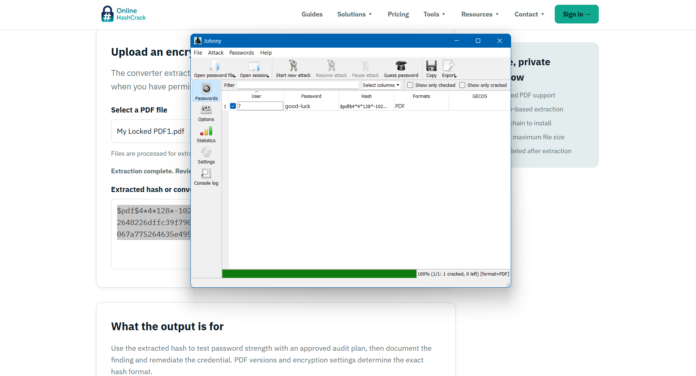
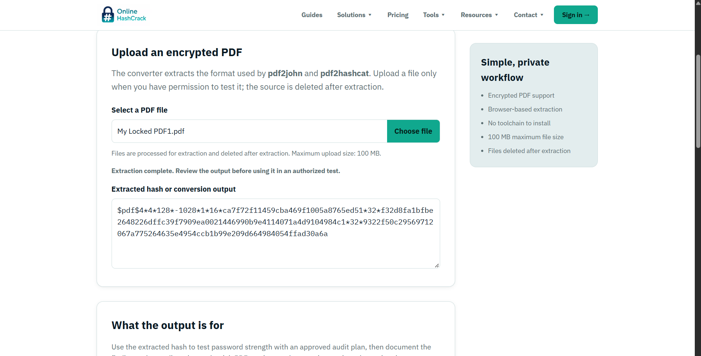
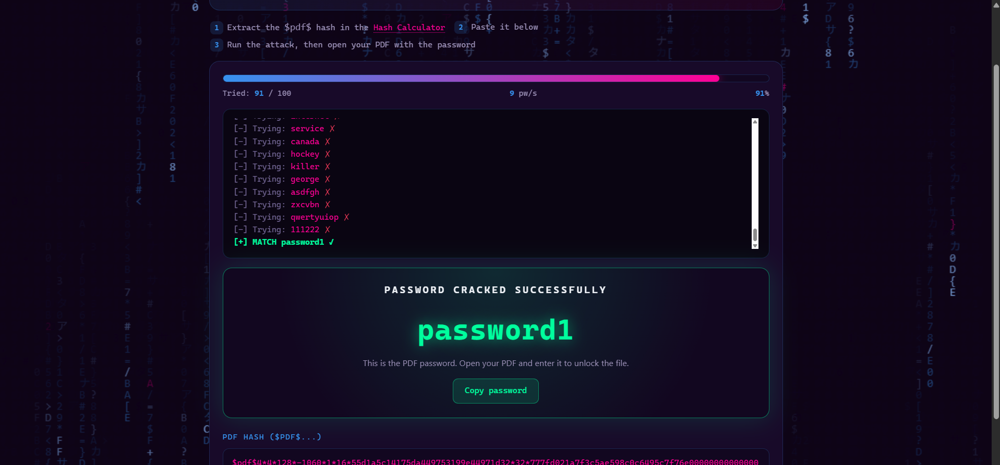

# Task 2 – Password Auditing Using John the Ripper and NetworkWalks Password Cracker

## Objective
Explore password-auditing tools and understand dictionary-based password testing in an authorised lab.

## Tools
- John the Ripper (Johnny graphical interface).
- NetworkWalks Password Cracker.

## Activities
- Opened the Johnny interface and reviewed its password-auditing workflow.
- Examined the PDF hash workflow used in the lab.
- Ran the password-cracking demonstration against the lab PDF.
- Observed candidate-password attempts during the dictionary-based test.
- Reviewed the successful recovery result.

## Observation
The demonstrations showed how password-auditing tools test candidate passwords against a hash. The lab password-cracking exercise displayed a successful recovery result. Screenshots are included as supplied.

## Outcome
Successfully observed password recovery during the authorised lab exercise and gained practical exposure to password-auditing workflows.

## Screenshots

**John the Ripper (Johnny) interface**

**PDF hash workflow**

**Password recovery result**

## Learning
This task introduced dictionary-based password testing, password-auditing interfaces, and the importance of strong and unique passwords.
